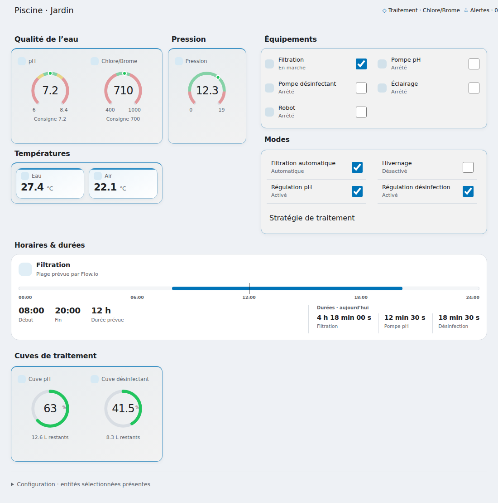
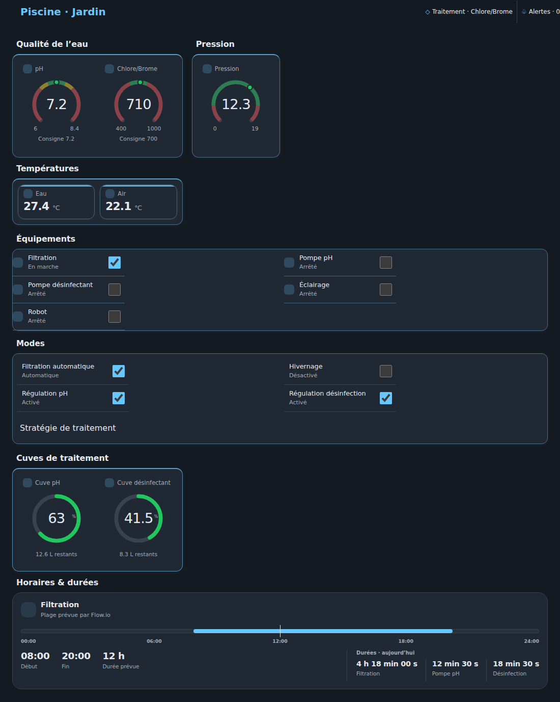
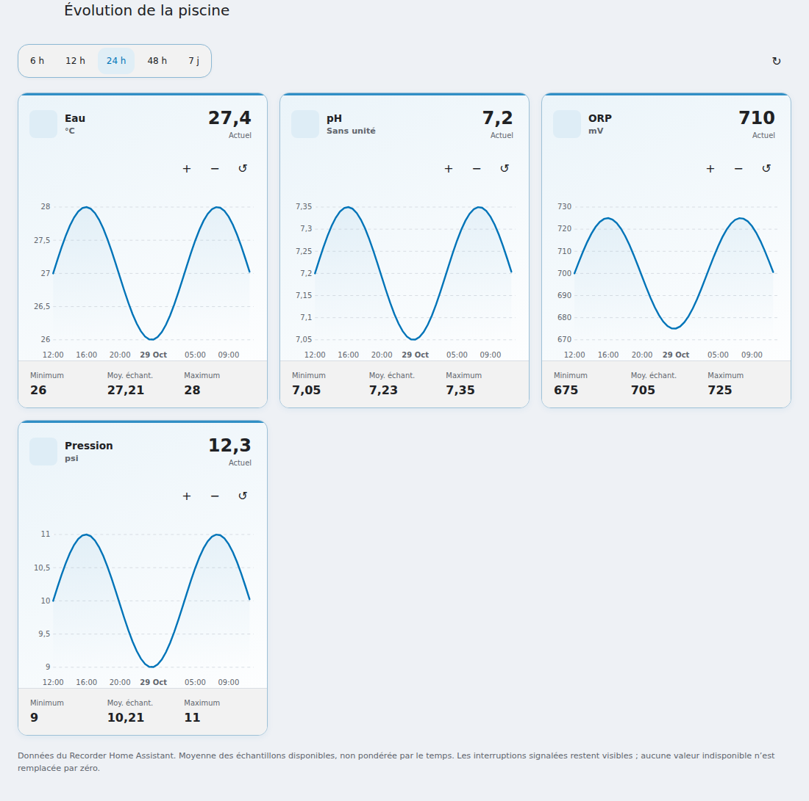
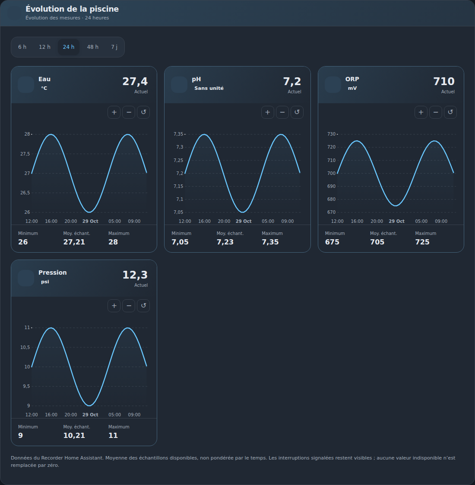

# Flow.io Home Assistant Cards

Cartes de supervision et de pilotage pour les entités MQTT du firmware Flow.io-Waveshare. La version 0.3.2 est en préparation ; le brouillon de release et la publication restent des étapes distinctes. Les préversions existantes ne sont pas modifiées.

| Carte Piscine — clair | Carte Piscine — sombre |
|---|---|
|  |  |

| Historiques — clair | Historiques — sombre |
|---|---|
|  |  |

## Cartes

- `custom:flowio-pool-card` : jauges pH/ORP/pression, températures, équipements, modes, alarmes, cuves et frise de filtration.
- `custom:flowio-history-card` : courbes ApexCharts alimentées par l'historique Home Assistant/Recorder.

Les cartes reprennent le thème Home Assistant. Les équipements et modes utilisent le composant natif `ha-switch` de l'instance, sans interrupteur de remplacement dans le bundle de production.

## Installation

Après publication d'une release vérifiée, ajouter `ben33880/flowio-home-assistant-cards` aux dépôts personnalisés HACS, catégorie Dashboard. Le dépôt n'est pas ajouté automatiquement au catalogue HACS par défaut.

Ressource attendue : `/hacsfiles/flowio-home-assistant-cards/flowio-home-assistant-cards.js`, type module JavaScript. Ne pas charger simultanément une ancienne copie manuelle. Voir [installation HACS et manuelle](docs/HACS.md).

## Synthèse

```yaml
type: custom:flowio-pool-card
title: Supervision & pilotage
entity_prefix: fio
display:
  measurements: [ph, orp, pressure, water_temperature, air_temperature]
  setpoints: [ph_setpoint, orp_setpoint]
  equipment: [filtration, ph_pump, disinfection_pump, lighting]
  modes: [filtration_auto, winter, ph_auto, disinfection_auto, heater_auto, disinfection_type, swg_control, ph_dose_plus, o2_temp_comp]
  tanks: [ph_tank_percent, disinfection_tank_percent]
  timing: [filtration_schedule, filtration_runtime, ph_runtime, disinfection_runtime]
  operations: [refill_ph, refill_disinfection, timed_override]
  calculated_values: [v00, v01]
  device_metrics: [water_in, water_out, current]
  information: [treatment_type, alarm_active, alarm_count, diagnostics, network, system]
tank_slots:
  ph: 1
  disinfection: 2
runtime_slots:
  filtration: 0
  ph: 1
  disinfection: 2
```

Choisir uniquement les éléments souhaités dans l'éditeur. Une liste vide masque le groupe. Les modes sont en outre filtrés selon les équipements cochés, sans effacer la sélection `display.modes` et sans changer un état du firmware. Par exemple, le pilotage électrolyseur apparaît seulement si `electrolyzer` est sélectionné.

Le préfixe vaut `fio` par défaut : `piscine` construit `sensor.piscine_io_ph`. Un préfixe vide est accepté. Les noms métier du firmware sont conservés ; aucun choix automatique d'une entité suffixée `_2`.

Les anciens champs `entities`, `features`, `show_tanks`, `treatment` et `measurements` au premier niveau de la synthèse sont rejetés. Recréer les anciennes configurations avec `display`. Pour les historiques, `measurements` reste au premier niveau.

## Historiques

```yaml
type: custom:flowio-history-card
entity_prefix: fio
hours_to_show: 24
measurements: [water_temperature, ph, orp, pressure]
calculated_values: [v00, v01]
```

Le Recorder doit fournir les historiques des entités choisies. Les valeurs calculées peuvent aussi être affichées dans la carte piscine avec `display.calculated_values`. La carte ne remplace pas la configuration du Recorder.

## Commandes et limites

- Consulter une valeur ouvre les informations de l'entité ; changer un contrôle peut commander la piscine.
- Les boutons de remplissage et de remise à zéro, ainsi que les commandes de forçage temporaire, s’affichent uniquement lorsqu’ils sont sélectionnés. Une confirmation précède chaque action ; le forçage utilise la sélection globale Home Assistant du firmware.
- La télémétrie d’équipement et les valeurs calculées sont en lecture seule. Les métriques équipement utilisent `device_slot` (0–15) ; vérifier l’affectation dans Flow.io. Réseau Wi-Fi et diagnostic système s’ajoutent via `display.information`.
- Les démarrages sensibles et certains changements de stratégie demandent confirmation.
- Un appel de service accepté ne confirme pas physiquement la marche d'un appareil. Les modes affichés suivent le retour d'état Home Assistant.
- Désactiver un automatisme ne signifie pas nécessairement arrêter sa sortie.
- Les protections, interlocks et règles de dosage restent dans Flow.io. La carte ne garantit pas la qualité de l'eau.
- La frise représente une plage prévue, distincte des compteurs journaliers.
- Les cuves affichent des estimations firmware. Vérifier les slots et la diffusion HA des valeurs ; une absence n'est pas transformée en zéro.
- Le dialogue d'alarme n'acquitte que via les boutons individuels disponibles exposés par le firmware.
- Les composants internes de Home Assistant peuvent évoluer : valider le rendu sur la version réellement utilisée. Aucune version minimale HA n'est annoncée sans vérification.

## Développement et release

Node.js 24 et ubuntu-24.04 sont conservés.

```sh
nvm install
nvm use
npm ci
npm test
npm run build
npx playwright install chromium
npm run test:e2e
```

Le lockfile est versionné et utilisé par la CI et les releases avec `npm ci`. Pour toute modification volontaire des dépendances, mettre à jour le lockfile via le workflow manuel de préparation, puis revoir et fusionner sa PR. Les tests unitaires incluent `tests/` et `src/`.

La démo utilise des données fictives et un substitut de `ha-switch` limité à `demo/`. Elle ne valide ni le véritable frontend HA ni le matériel. Les tests ne commandent aucun équipement réel.

Voir [procédure de release](docs/RELEASE.md) et [notes 0.3.2](docs/releases/v0.3.2.md). Le workflow stable crée uniquement un brouillon après validation ; la publication reste une action manuelle distincte.

## Licence

Le code du projet est distribué sous [licence MIT](LICENSE). Les dépendances conservent leurs propres licences. La préparation de release copie leurs mentions depuis les paquets effectivement inclus dans le build et les joint au bundle.
